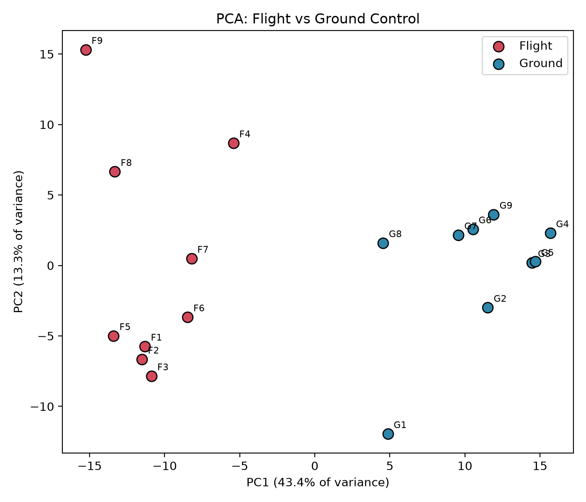
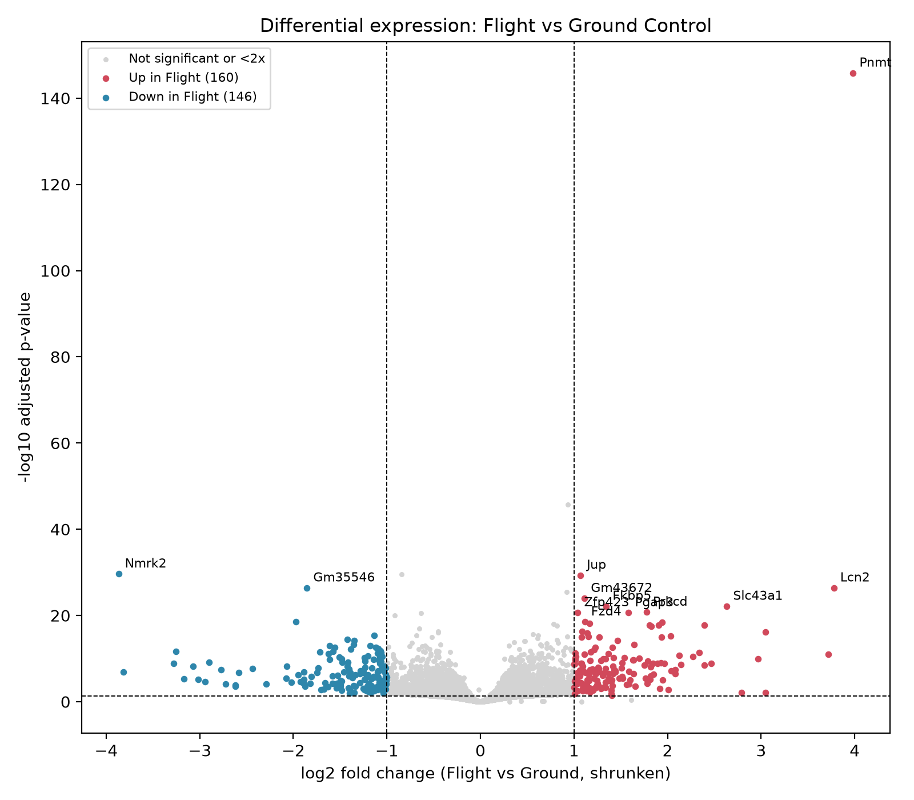
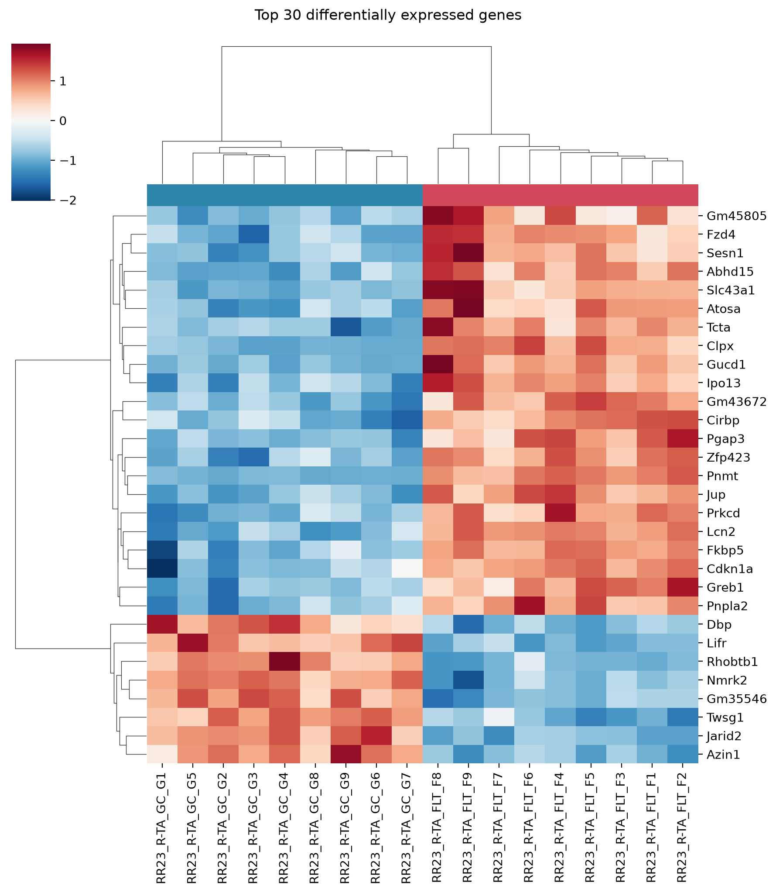
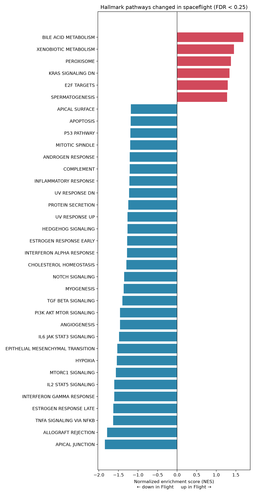

# How Spaceflight Changes Gene Expression in Mouse Muscle

> **Question:** Which genes and biological pathways change in mouse skeletal muscle after ~38 days on the International Space Station, compared with ground-control mice housed in identical habitats?

## Why it matters

Long missions to the Moon and Mars will expose astronauts to months of microgravity, and muscle loss is one of the best-documented risks. Understanding *which* molecular pathways change in muscle during spaceflight helps researchers design countermeasures such as drugs, exercise programs, or nutrition plans. This project reanalyzes public NASA data to identify those changes.

## Key findings

- **4,234 of 16,054 genes** changed significantly between Flight and Ground mice (FDR < 0.05). Most changes were modest: **306 genes** changed at least 2-fold (160 up, 146 down in Flight).
- **A strong stress-hormone signature.** Several top genes are known to respond to glucocorticoid (stress hormone) signaling, including *Pnmt* (~16x up, the most significant gene), *Fkbp5*, *Lcn2*, *Sesn1*, and *Cdkn1a*.
- **Immune and inflammatory signaling was suppressed** in Flight mice (TNFα/NF-κB, IL-6/JAK/STAT3, interferon-γ, complement). Because glucocorticoids are anti-inflammatory, this fits the stress-hormone signature.
- **Muscle growth signaling was reduced:** mTORC1 (FDR 0.027) and PI3K/AKT/mTOR (FDR 0.044) pathways were down. mTOR drives muscle protein synthesis, consistent with spaceflight-associated muscle loss.
- **Structural and support pathways were down** (cell junctions, extracellular matrix, angiogenesis), while **fat-metabolism pathways were up** (peroxisome, bile acid metabolism).
- **Data quality catch:** synthetic ERCC spike-in controls initially appeared among the top "genes." I identified and removed them, then confirmed the main results held.

<p align="center">
  
  
</p>
<p align="center">
  
  
</p>

## Data

- **Source:** NASA Open Science Data Repository (OSDR), study **OSD-576** (Rodent Research-23)
- **Tissue:** right tibialis anterior (lower leg muscle)
- **Animals:** male C57BL/6J mice, ~38 days on the ISS
- **Comparison:** 9 Space Flight vs 9 Ground Control (habitat) mice
- **Excluded:** 9 Vivarium controls, which lived in standard cages rather than the flight habitat hardware
- **File used:** `GLDS-570_rna_seq_RSEM_Unnormalized_Counts_rRNArm_GLbulkRNAseq.csv` (GeneLab-processed raw counts, ribosomal RNA genes removed)

## Methods

1. **Exploration (Python, pandas):** inspected the count table and metadata, confirmed sample labels against the OSDR sample table, and built a sample sheet.
2. **Quality control (Python, scikit-learn):** removed 92 ERCC spike-in controls; kept genes with ≥10 reads in ≥9 samples (16,054 of 56,832 genes); checked library sizes; ran PCA and sample correlation clustering. All 18 samples were retained.
3. **Differential expression (R, DESeq2):** design `~ condition` with Ground as the reference; fold changes shrunk with apeglm for ranking and plotting.
4. **Annotation and visualization (Python, mygene, seaborn):** mapped Ensembl IDs to gene symbols; made a volcano plot and a heatmap of the top 30 genes.
5. **Pathway analysis (Python, gseapy):** pre-ranked GSEA on DESeq2 Wald statistics using MSigDB 2026.2.Mm Hallmark and GO Biological Process gene sets (1,000 permutations, seed 42).

## Quality control highlights

- Flight and Ground samples **separate completely along PC1** (41.8% of variance), and clustering splits them perfectly into two groups.
- Library sizes were similar between groups (68–103 million reads per sample).
- No samples were flagged as outliers by DESeq2 (Cook's distance), supporting the decision to keep all 18.
- Removing ERCC spike-ins reduced significant genes from 4,293 to 4,234 but did not change the top biological genes or the PCA separation.

## Limitations

- **Spaceflight is confounded with the return to Earth.** Flight mice splashed down, were transported by helicopter and plane, and were dissected the next day. Part of the stress-hormone signature may reflect landing and transport rather than microgravity.
- **Groups were dissected on different days** (Flight on Jan 14, Ground Control on Jan 17, 2021). Timing differences could affect results, including circadian genes such as *Dbp* (down ~4x).
- **The stress-hormone hypothesis is not fully confirmed.** Individual marker genes changed strongly, but the GO "cellular response to glucocorticoid stimulus" gene set was not significant (FDR 0.43), possibly because these sets mix genes that glucocorticoids turn on and off.
- **Mitochondrial results differ from prior work.** Oxidative phosphorylation showed no change (Hallmark NES −0.57, FDR 0.997), unlike a 2026 preprint reporting strong suppression in this dataset. Differences in gene sets, count files, and filtering likely explain this; that preprint itself concluded mitochondrial results are method-sensitive.
- **Single mission, single tissue, male mice only.** Results may not generalize to other muscles, missions, or females.
- **Bulk tissue.** Changes could reflect shifts in cell composition rather than changes within muscle cells.

## Next steps

- Compare my differential expression results with GeneLab's own processed results for this study
- Test whether results hold when the most extreme Flight sample (F9) is left out
- Repeat the analysis on other Rodent Research muscle datasets to see which findings replicate

## Repository structure

```
├── data/
│   ├── raw/              # downloaded from OSDR (not tracked by Git)
│   ├── processed/        # filtered counts (not tracked by Git)
│   └── samples.csv       # sample sheet: 9 Flight, 9 Ground
├── notebooks/
│   ├── 01_explore.ipynb      # data exploration
│   ├── 02_qc.ipynb           # QC, filtering, PCA
│   ├── 03_plots.ipynb        # annotation, volcano plot, heatmap
│   └── 04_enrichment.ipynb   # GSEA pathway analysis
├── scripts/
│   └── 02_deseq2.R           # differential expression
├── results/              # DESeq2 and GSEA output tables
├── figures/              # all plots
├── notes.md              # analysis notes and decisions log
└── requirements.txt
```

## How to reproduce

```bash
# Python environment
python -m venv .venv
source .venv/bin/activate
pip install -r requirements.txt
```

```r
# R packages (R 4.6)
install.packages("BiocManager")
BiocManager::install(c("DESeq2", "apeglm"))
```

1. From the [OSD-576 study page](https://osdr.nasa.gov/bio/repo/data/studies/OSD-576), download the RSEM rRNA-removed unnormalized counts file and the ISA metadata into `data/raw/`.
2. Run `notebooks/01_explore.ipynb` and `notebooks/02_qc.ipynb`.
3. Run `scripts/02_deseq2.R` from the project root (e.g., via the RStudio project).
4. Run `notebooks/03_plots.ipynb` and `notebooks/04_enrichment.ipynb`.

R and package versions are recorded in `results/sessionInfo_deseq2.txt`.

## References

- Love, M. I., Huber, W. & Anders, S. (2014). Moderated estimation of fold change and dispersion for RNA-seq data with DESeq2. *Genome Biology* 15, 550.
- Subramanian, A. et al. (2005). Gene set enrichment analysis: a knowledge-based approach for interpreting genome-wide expression profiles. *PNAS* 102, 15545–15550.
- da Silveira, W. A. et al. (2020). Comprehensive multi-omics analysis reveals mitochondrial stress as a central biological hub for spaceflight impact. *Cell* 183, 1185–1201.
- Polo, S.-H. L. et al. (2020). RNAseq analysis of rodent spaceflight experiments is confounded by sample collection techniques. *iScience*.
- Ganti, S. (2026). Mitochondrial transcriptomic responses to real spaceflight vary across mouse tissue-mission contexts. *Research Square* (preprint).
- NASA Open Science Data Repository: https://osdr.nasa.gov/

## Author

[Rayyan Siddiqui] · [www.linkedin.com/in/rayyan-siddiqui12] · [rayyansiddiquizz060@gmail.com]